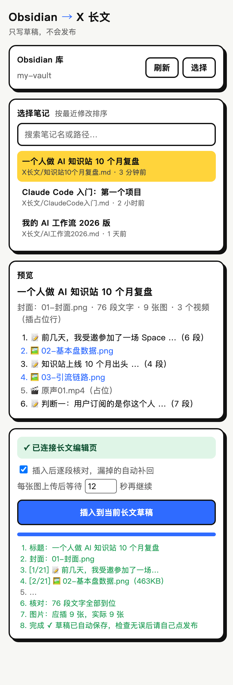
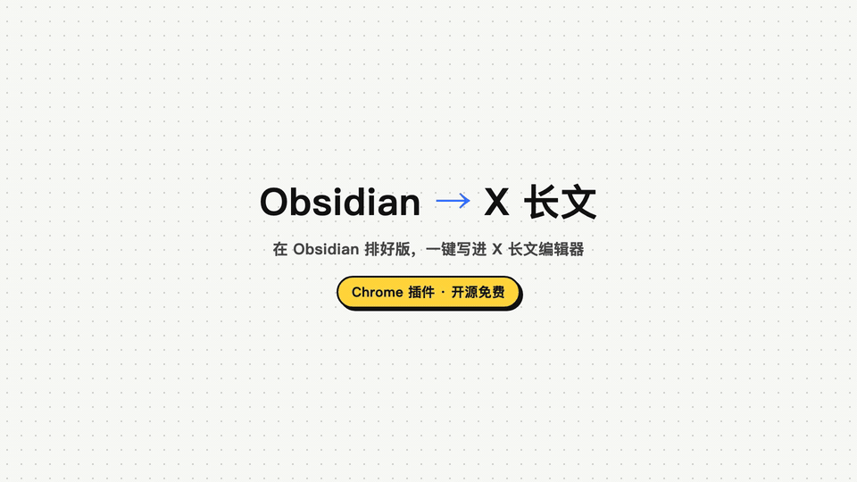

<div align="center">

# 麦田发布助手

**麦田工作台的发布引擎：一期视频，一键填好 B 站、小红书、抖音、视频号、YouTube、X 六个平台；Obsidian 笔记，一键写进 X 长文。**

只负责填写，最后的「发布」由你自己点。可以单独用，也可以交给 [麦田](https://github.com/CzzzzzzJ/mdldm-maitian) 定时调度、发完自动取链接、每天采数据。

[](manifest.json)
[](manifest.json)
[](LICENSE)

[安装](#安装) · [和麦田一起用](#和麦田一起用) · [视频多平台分发](#视频多平台分发) · [X 长文](#x-长文使用) · [原理](#原理和踩过的坑)

[麦田工作台](https://github.com/CzzzzzzJ/mdldm-maitian) · [X / Twitter](https://x.com/czzzzzzJ_) · [联系作者](#联系作者)

</div>

> [!TIP]
> **想系统学会用 AI 做这类小工具？** 这个插件是我用 Claude Code 做出来的。从 0 基础到用 AI 做出自己的产品，完整课程和每周直播都在 👉 **[麦当的知识站 mdldm.club](https://www.mdldm.club/)**

<p align="center"></p>
<p align="center"><sub>视频分发流程演示（示意界面，<a href="docs/assets/publish-demo.mp4">高清 MP4</a>）</sub></p>

## 它能做什么

### 视频多平台分发（v0.2 新增）

| 能力 | 说明 |
| --- | --- |
| 一个工程文件 | 每期视频一个目录：成片、封面、`publish.json`（各平台标题、正文、标签、用哪张封面） |
| 六个平台一键填写 | 自动打开 B 站、小红书、抖音、视频号、YouTube、X 的上传页，传视频、传封面、填标题正文、选话题 |
| 大文件直传 | 视频通过 Chrome 调试接口直接交本地路径，1.5GB 的成片也不卡 |
| 发前校验 | 字数上限、必带标签、小红书/抖音/视频号不放链接和微信号，有问题先拦下 |
| 等上传完再补封面 | 小红书、视频号要等视频传完才能改封面，插件在后台等着，传完自动补上 |
| 定时发布 | `publish.json` 写上时间，六个平台的定时都会设好（B 站、小红书、抖音、视频号、YouTube、X） |
| 不打扰 | 上传页在后台打开，填写时不抢你正在看的页面；关掉面板也继续跑，工具栏图标显示进度，结束弹通知 |
| 安全 | 只填写，**不会点发布**；每个平台一张状态卡，跳过了什么、哪里异常都写清楚 |

### X 长文

| 能力 | 说明 |
| --- | --- |
| 直连本地 Obsidian | 选一次库文件夹，之后直接读取笔记和图片，不需要装 Obsidian 插件 |
| 按顺序插入 | 标题、封面、段落、小标题、引用、列表、链接、图片，和笔记里的顺序一致 |
| 自动处理图片 | 支持 `![[图片]]` 和 ``，大图自动压缩，每张图等上传稳定后再继续 |
| 逐段核对 | 插完自动对照原文，漏掉的段落补回原位 |
| 安全 | 只写草稿，**不会点发布**；插入中途切换标签页也不影响 |

<p align="center"></p>

## 安装

1. 下载本仓库：`git clone https://github.com/CzzzzzzJ/mdldm-maitian-publisher.git`，或点右上角 **Code → Download ZIP** 后解压
2. Chrome 打开 `chrome://extensions`，打开右上角「开发者模式」
3. 点「加载已解压的扩展程序」，选择仓库文件夹
4. 点工具栏的拼图图标，把「麦田发布助手」固定出来

## 和麦田一起用

[麦田](https://github.com/CzzzzzzJ/mdldm-maitian) 是一套给多平台博主的开源工作台：分发和定时、各平台数据留存和大屏、接入你自己的站点看转化。三者分工：

| 部分 | 做什么 |
| --- | --- |
| 发布 skill（在麦田仓库 `skills/`） | 让 AI 助手看片、写各平台文案、生成 `publish.json` 并校验 |
| **麦田发布助手（本仓库）** | 各平台适配器：打开上传页、传视频和封面、填文案、设定时 |
| 麦田 | 什么时候跑、跑到哪、防重、到点取链接、每天采数据、飞书通知 |

麦田直接加载本仓库的 `lib/`（在 `config.json` 的 `pluginDir` 填本仓库路径），所以平台改版只需要更新这一个仓库。单独用插件时，按下面「视频多平台分发」在侧边栏里操作即可。

## 视频多平台分发

1. 每期视频准备一个工程目录（建议放在 NAS 或固定的「视频导出」文件夹下）：

   ```
   视频导出/系列名/第几期/
     成片.mp4
     封面/cover-3x4.png   竖：小红书、抖音竖封面、视频号个人主页卡片
     封面/cover-4x3.png   横：B 站、抖音横封面、视频号分享卡片
     封面/cover-16x9.jpg  YouTube 缩略图
     publish.json
   ```

   `publish.json` 的格式见 [docs/multi-platform-design.md](docs/multi-platform-design.md)。也可以从发布素材 md 直接生成：`node tools/make-publish.mjs <发布素材.md> <工程目录>`（会顺带校验）
2. 先在 Chrome 里登录好各个平台的创作者后台
3. 打开插件面板，切到「视频分发」，点「选择」选中「视频导出」文件夹，并填好它在本机的绝对路径
4. 点一期工程，看校验结果，勾选要发的平台，点「一键填写所选平台」
5. 插件在后台依次打开各平台上传页并填写，你可以关掉面板去做别的。工具栏图标会显示进度，结束时弹通知
6. 全部变成「待你发布」后，逐个标签页检查、补上必填的声明项，自己点发布（设了定时就点「定时发布」）

> 浏览器顶部会出现「正在调试此浏览器」的提示条，这是插件用 Chrome 调试接口上传本地视频，填写结束后会自动断开。
> 各平台上传页的结构和实测细节见 [docs/platform-notes.md](docs/platform-notes.md)。

## X 长文使用

<p align="center"></p>

1. 在 X 上新建一篇长文，停在编辑页（`x.com/compose/articles/edit/...`）
2. 点工具栏的插件图标，右侧打开面板，切到「X 长文」
3. 第一次使用：点「选择」，选中你的 Obsidian 库文件夹。之后每次打开面板，最多点一下「授权」
4. 在列表里点选笔记（按最近修改排序，可搜索），确认预览里的结构和图片
5. 点「插入到当前长文草稿」，等进度跑完，检查后自己发布

> X 长文（Articles）需要开通 X 的付费订阅才能使用。

## 笔记写法

照平时的 Obsidian 写法就行：

| Obsidian 里 | X 长文里 |
| --- | --- |
| frontmatter `title:`，或第一个 `# H1` | 标题 |
| frontmatter `cover:`，或 H1 后、正文前的第一张图 | 封面（建议 5:2） |
| H1 之前的内容 | 忽略，适合写备注、发布清单 |
| `##` / `###` | 小标题 |
| 每一行文字 | 一个段落 |
| `**加粗**` `==高亮==` `*斜体*` `~~删除线~~` `[文字](链接)` | 对应格式（高亮转成加粗） |
| `> 引用`、`> [!tip] callout` | 引用块 |
| `- 列表`、`1. 列表` | 无序 / 有序列表 |
| `![[图片.png]]`、`` | 图片，按出现顺序插入 |
| `![[视频.mp4]]` | 一行加粗占位文字，视频需在编辑器里手动上传 |
| `---` 分割线、`%%注释%%` | 忽略 |

图片按「笔记所在目录 → 库根目录 → 全库同名文件」的顺序查找。超过 4MB 或不是 PNG/JPEG/WebP 的图会自动压成 JPEG。

<details>
<summary>示例笔记</summary>

```markdown
---
tags: [X长文]
---
> 发布前：补充回放链接（这行在 H1 之前，不会被插入）

# 一个人做 AI 知识站 10 个月复盘
![[01-封面.png]]

前几天，我受邀参加了一场 Space。

## 先交代基本盘
![[02-基本盘数据.png]]
- 知识站上线 **10 个月**
- 唯一 SKU：**500 元/年**

> 用户订阅的是你这个人，而不是某一节课。
```

</details>

## 原理和踩过的坑

X 长文编辑器基于 Draft.js。插件用 `chrome.scripting.executeScript({ world: 'MAIN' })` 在页面里运行 [`lib/engine.js`](lib/engine.js)，通过 React fiber 拿到 `editorState`，再用模拟粘贴写入内容。

- **光标**：DOM selection 对 Draft 不可靠，每次写入前都用 `forceSelection` 把光标放到文末
- **格式丢失**：粘贴片段的第一块会并入光标所在块，并继承它的格式（小标题会变成普通段落）。所以每段前面垫一个零宽占位段落，写完再统一清理
- **图片被冲掉**：图片刚上传完立刻写文字，图片会消失。所以每张图之后等待几秒（面板里可调，默认 12 秒）
- **封面**：页面上的 `input[data-testid=fileInput]` 是封面上传入口，不是正文插图
- **漏段**：插完按顺序核对每段文字，缺了就在原位补回（补回的段落不带加粗和链接）

> 这是非官方工具，依赖 X 编辑器的页面结构。X 改版后可能失效，欢迎提 Issue。

### 视频分发的做法

各平台上传页都用 `chrome.debugger`（Chrome DevTools Protocol）操作：[`lib/cdp.js`](lib/cdp.js) 用 `DOM.setFileInputFiles` 把本地绝对路径交给上传框（能穿透 Shadow DOM，大视频不经过 JS 内存），用 `Input.insertText` 和真实按键输入文字，需要悬停才出现的按钮用真实鼠标事件。每个平台一个适配器，放在 [`lib/platforms/`](lib/platforms/)，平台改版只需要修对应的文件。

### 文件

- `sidepanel.*`：面板界面；`video.js`：视频分发页签
- `lib/publish.js`：扫描工程、按平台调度、等上传完成
- `lib/bundle.js`：`publish.json` 校验规则（`tools/validate.mjs` 是命令行版）
- `lib/platforms/*.js`：B 站、小红书、抖音、视频号、YouTube、X 的适配器
- `lib/cdp.js`：Chrome 调试接口驱动
- `lib/devbridge.js`、`tools/`：开发用的本机桥接，只在「加载已解压的扩展程序」时启用
- `lib/md.js`：Obsidian Markdown → 片段（测试：`node tests/md.test.mjs <笔记路径>`）
- `lib/engine.js`：在编辑页里执行的插入引擎
- `lib/vault.js`：读取本地库（File System Access API，授权句柄存在 IndexedDB）

## 联系作者

本项目由 **麦当mdldm** 开发，是我「一人公司」内容工作流里的一环。

- **想学会用 AI 做出自己的工具和产品**：访问 👉 [**麦当的知识站 mdldm.club**](https://www.mdldm.club/)。0 基础 AI Agent / Vibe Coding 系列课、每周会员直播、答疑群都在这里
- **想搭一个自己的知识付费站**：看我开源的 [mdldm Knowledge Kit](https://github.com/CzzzzzzJ/mdldm-knowledge-kit)
- **Bug 和功能建议**：提 [GitHub Issue](https://github.com/CzzzzzzJ/mdldm-maitian-publisher/issues)
- **课程合作、品牌合作、企业 AI 培训**：通过 [X / Twitter](https://x.com/czzzzzzJ_) 或 [个人联系页](https://www.mdldm.club/about) 联系，或在 B 站、小红书、抖音搜索 **麦当mdldm**

| 个人微信 |
| --- |
|  |
| 扫码添加，备注 `X长文插件` |

如果这个插件帮你省了时间，欢迎点个 ⭐ Star，也欢迎在 X 上 [@czzzzzzJ_](https://x.com/czzzzzzJ_) 告诉我你用它发了什么。

## License

[Apache License 2.0](LICENSE)。Apache-2.0 不授予 `mdldm`、麦当名称或 Logo 的商标权。
