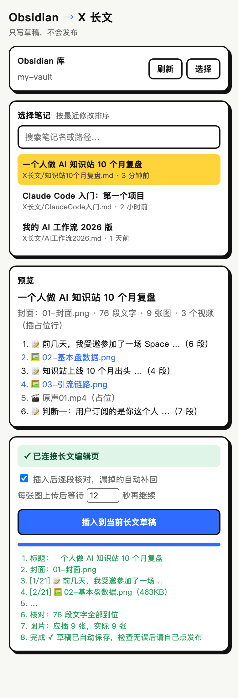

<div align="center">

# Obsidian → X 长文

**在 Obsidian 里排好版，一键把标题、封面、文字和图片按顺序写进 X 长文编辑器。**

给在 X 上写长文、用 Obsidian 管理内容的创作者。不用再一段一段复制、一张一张传图。

[](manifest.json)
[](manifest.json)
[](LICENSE)

[安装](#安装) · [使用](#使用) · [笔记写法](#笔记写法) · [原理](#原理和踩过的坑)

[麦当的知识站](https://www.mdldm.club/) · [X / Twitter](https://x.com/czzzzzzJ_) · [联系作者](#联系作者)

</div>

> [!TIP]
> **想系统学会用 AI 做这类小工具？** 这个插件就是我用 Claude Code 一个下午做出来的。从 0 基础到用 AI 做出自己的产品，完整课程和每周直播都在 👉 **[麦当的知识站 mdldm.club](https://www.mdldm.club/)**

<p align="center"></p>

## 它能做什么

| 能力 | 说明 |
| --- | --- |
| 直连本地 Obsidian | 选一次库文件夹，之后直接读取笔记和图片，不需要装 Obsidian 插件 |
| 按顺序插入 | 标题、封面、段落、小标题、引用、列表、链接、图片，和笔记里的顺序一致 |
| 自动处理图片 | 支持 `![[图片]]` 和 ``，大图自动压缩，每张图等上传稳定后再继续 |
| 逐段核对 | 插完自动对照原文，漏掉的段落补回原位 |
| 安全 | 只写草稿，**不会点发布**；插入中途切换标签页也不影响 |

## 安装

1. 下载本仓库：`git clone https://github.com/CzzzzzzJ/obsidian-x-publisher.git`，或点右上角 **Code → Download ZIP** 后解压
2. Chrome 打开 `chrome://extensions`，打开右上角「开发者模式」
3. 点「加载已解压的扩展程序」，选择仓库文件夹
4. 点工具栏的拼图图标，把「Obsidian → X 长文」固定出来

## 使用

1. 在 X 上新建一篇长文，停在编辑页（`x.com/compose/articles/edit/...`）
2. 点工具栏的插件图标，右侧打开面板
3. 第一次使用：点「选择」，选中你的 Obsidian 库文件夹。之后每次打开面板，最多点一下「授权」
4. 在列表里点选笔记（按最近修改排序，可搜索），确认预览里的结构和图片
5. 点「插入到当前长文草稿」，等进度跑完，检查后自己发布

> X 长文（Articles）需要开通 X 的付费订阅才能使用。

## 笔记写法

照平时的 Obsidian 写法就行：

| Obsidian 里 | X 长文里 |
| --- | --- |
| frontmatter `title:`，或第一个 `# H1` | 标题 |
| frontmatter `cover:`，或 H1 后、正文前的第一张图 | 封面（建议 5:2） |
| H1 之前的内容 | 忽略，适合写备注、发布清单 |
| `##` / `###` | 小标题 |
| 每一行文字 | 一个段落 |
| `**加粗**` `==高亮==` `*斜体*` `~~删除线~~` `[文字](链接)` | 对应格式（高亮转成加粗） |
| `> 引用`、`> [!tip] callout` | 引用块 |
| `- 列表`、`1. 列表` | 无序 / 有序列表 |
| `![[图片.png]]`、`` | 图片，按出现顺序插入 |
| `![[视频.mp4]]` | 一行加粗占位文字，视频需在编辑器里手动上传 |
| `---` 分割线、`%%注释%%` | 忽略 |

图片按「笔记所在目录 → 库根目录 → 全库同名文件」的顺序查找。超过 4MB 或不是 PNG/JPEG/WebP 的图会自动压成 JPEG。

<details>
<summary>示例笔记</summary>

```markdown
---
tags: [X长文]
---
> 发布前：补充回放链接（这行在 H1 之前，不会被插入）

# 一个人做 AI 知识站 10 个月复盘
![[01-封面.png]]

前几天，我受邀参加了一场 Space。

## 先交代基本盘
![[02-基本盘数据.png]]
- 知识站上线 **10 个月**
- 唯一 SKU：**500 元/年**

> 用户订阅的是你这个人，而不是某一节课。
```

</details>

## 原理和踩过的坑

X 长文编辑器基于 Draft.js。插件用 `chrome.scripting.executeScript({ world: 'MAIN' })` 在页面里运行 [`lib/engine.js`](lib/engine.js)，通过 React fiber 拿到 `editorState`，再用模拟粘贴写入内容。

- **光标**：DOM selection 对 Draft 不可靠，每次写入前都用 `forceSelection` 把光标放到文末
- **格式丢失**：粘贴片段的第一块会并入光标所在块，并继承它的格式（小标题会变成普通段落）。所以每段前面垫一个零宽占位段落，写完再统一清理
- **图片被冲掉**：图片刚上传完立刻写文字，图片会消失。所以每张图之后等待几秒（面板里可调，默认 12 秒）
- **封面**：页面上的 `input[data-testid=fileInput]` 是封面上传入口，不是正文插图
- **漏段**：插完按顺序核对每段文字，缺了就在原位补回（补回的段落不带加粗和链接）

> 这是非官方工具，依赖 X 编辑器的页面结构。X 改版后可能失效，欢迎提 Issue。

### 文件

- `sidepanel.*`：面板界面和整体流程
- `lib/md.js`：Obsidian Markdown → 片段（测试：`node tests/md.test.mjs <笔记路径>`）
- `lib/engine.js`：在编辑页里执行的插入引擎
- `lib/vault.js`：读取本地库（File System Access API，授权句柄存在 IndexedDB）

## 联系作者

本项目由 **麦当mdldm** 开发，是我「一人公司」内容工作流里的一环。

- **想学会用 AI 做出自己的工具和产品**：访问 👉 [**麦当的知识站 mdldm.club**](https://www.mdldm.club/)。0 基础 AI Agent / Vibe Coding 系列课、每周会员直播、答疑群都在这里
- **想搭一个自己的知识付费站**：看我开源的 [mdldm Knowledge Kit](https://github.com/CzzzzzzJ/mdldm-knowledge-kit)
- **Bug 和功能建议**：提 [GitHub Issue](https://github.com/CzzzzzzJ/obsidian-x-publisher/issues)
- **课程合作、品牌合作、企业 AI 培训**：通过 [X / Twitter](https://x.com/czzzzzzJ_) 或 [个人联系页](https://www.mdldm.club/about) 联系，或在 B 站、小红书、抖音搜索 **麦当mdldm**

| 个人微信 |
| --- |
|  |
| 扫码添加，备注 `X长文插件` |

如果这个插件帮你省了时间，欢迎点个 ⭐ Star，也欢迎在 X 上 [@czzzzzzJ_](https://x.com/czzzzzzJ_) 告诉我你用它发了什么。

## License

[Apache License 2.0](LICENSE)。Apache-2.0 不授予 `mdldm`、麦当名称或 Logo 的商标权。
